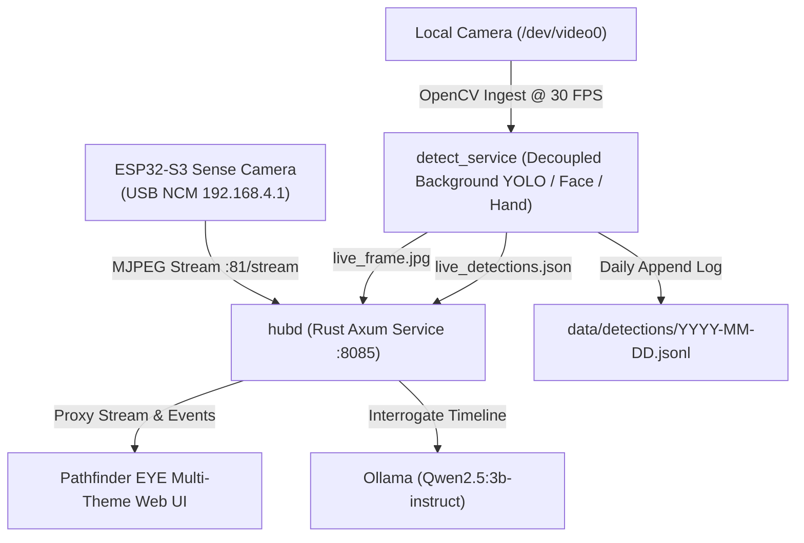

# Pathfinder EYE (ESP32-S3 Vision Hub)

A high-performance computer vision and telemetry edge hub bridging an ESP32-S3 camera module (over USB NCM Ethernet or UVC) with a host-side Rust orchestration daemon, decoupled YOLOv11M ONNX inference engine, 3D facial biometric tracking, client/backend 21-joint skeletal hand tracking with Japanese Sign Language (JSL) dictionary, append-only JSONL event persistence, and local SLM (Small Language Model) timeline interrogation.

---

## 1. System Architecture



### Components
- **`firmware/`**: ESP-IDF v5.3+ firmware for Seeed Studio XIAO ESP32-S3 Sense. Configures USB High-Speed NCM (CDC-NCM) with a built-in LwIP DHCP server (`192.168.4.1`) streaming camera frames over HTTP port 81.
- **`crates/hubd/`**: Core orchestrator and web server built with Axum and Tokio. Serves live JPEG proxies, atomic JSON telemetry, timeline querying, and forwards natural language questions to Ollama. Automatically manages detector background workers.
- **`crates/detect_service.py`**: High-performance vision service running a 30 FPS ingest thread decoupled from asynchronous background YOLOv11M inference, YuNet face tracking, and MediaPipe hand tracking. Includes exposure filters (DARK / NORM / BRIGHT).
- **`crates/hand_detector.py`**: MediaPipe ONNX 21-landmark neural geometry detector with custom Japanese Sign Language (JSL) and symbolic gesture classifier (JSL 1–5, Kitsune 🦊, Pinky Promise 🤙, OK/Money 👌, Thumbs Up 👍, Fist ✊).
- **`crates/face_service.py`**: YuNet & SFace biometric pipeline providing 128-dimensional facial embeddings and persistent subject enrollment.
- **`crates/detect/`**: Rust temporal debounce filtering crate guaranteeing object detection persistence and zone tracking across continuous frames.
- **`crates/vision/`**: Streaming MJPEG extraction engine parsing SOI (`0xFF 0xD8`) and EOI (`0xFF 0xD9`) frame boundaries.
- **`crates/store/`**: Structured JSON Lines append-only persistence layer supporting date partitioning and daily detection aggregation.
- **`ui/`**: Hardware-accelerated cybernetic web interface featuring Mazzaroth design themes (Midnight Gold, Synth Magenta, Obsidian Mono, Technical Paper), 3D face mesh wiring that follows head movement, live JSL gesture menu, and SLM console.

---

## 2. Key Features

- **Pathfinder EYE Rebranding & Unified HUD**: Modern industrial HUD with fixed-width telemetry counters, jitter-free latency badges, and clean mode navigation (`OBJECT_RECOGNITION`, `FACIAL_RECOGNITION`, `HAND_GESTURES`).
- **Mazzaroth Color Themes**: Instant palette switching across canvas wireframes, anchor crosshairs, typography, and controls with full persistence.
- **3D Biometric Facial Mesh Reticle**: 468-point 3D facial wireframe mesh tracking head movement and angular pitch/yaw in real time.
- **Japanese Sign Language (JSL) & Hand CV Dictionary**: Real-time 21-joint skeletal rendering with an interactive sidebar dictionary indicating active and ready gestures.
- **Decoupled 30 FPS Video Pipeline**: Asynchronous background YOLO inference ensures smooth, lag-free camera playback without video stalls.
- **Dynamic Lighting Compensation**: Quick-toggle exposure controls (`DARK [▲]`, `NORM`, `BRIGHT [▼]`) to instantly balance challenging indoor or outdoor lighting.
- **Local Timeline Interrogation**: Natural language timeline querying powered by local Ollama (`qwen2.5:3b-instruct`).

---

## 3. Getting Started

### Prerequisites
- Rust 1.78+ (`cargo`)
- Python 3.10+ in `.venv` with `ultralytics`, `onnxruntime`, `opencv-python-headless`
- Local Ollama running `qwen2.5:3b-instruct` (optional, for AI timeline queries)

### Running the System
```bash
vision
# Or via script:
./start.sh
```
Open **`http://localhost:8085`** in your browser.
