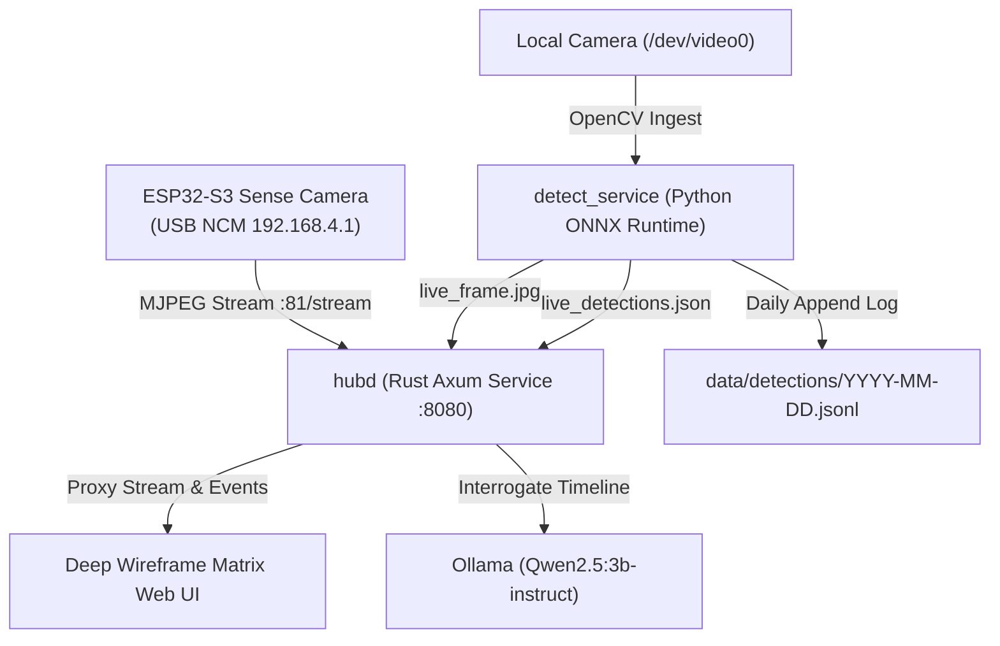

# ESP32-S3 Vision Hub

A high-performance computer vision and telemetry edge hub bridging an ESP32-S3 camera module (over USB NCM Ethernet) with a host-side Rust orchestration daemon, YOLOv11 ONNX inference engine, append-only JSONL event persistence, and local SLM (Small Language Model) timeline interrogation.

---

## 1. System Architecture



### Components
- **`firmware/`**: ESP-IDF v5.3+ firmware for Seeed Studio XIAO ESP32-S3 Sense. Configures USB High-Speed NCM (CDC-NCM) with a built-in LwIP DHCP server (`192.168.4.1`) streaming camera frames over HTTP port 81.
- **`crates/hubd/`**: Core orchestrator and web server built with Axum and Tokio. Serves live JPEG proxies, telemetry JSON, timeline querying, and forwards natural language questions to Ollama. Automatically spawns the vision detector child process.
- **`crates/detect/`**: Rust temporal debounce filtering crate guaranteeing object detection persistence and zone tracking across continuous frames.
- **`crates/detect_service.py`**: Lightweight, CPU-throttled YOLOv11 ONNX inference engine with single-core thread pinning and adaptive frame skipping to ensure low thermals and zero CPU fan spikes.
- **`crates/vision/`**: Streaming MJPEG extraction engine parsing SOI (`0xFF 0xD8`) and EOI (`0xFF 0xD9`) frame boundaries.
- **`crates/store/`**: Structured JSON Lines append-only persistence layer supporting date partitioning and daily detection aggregation.
- **`ui/`**: Hardware-accelerated cybernetic web interface featuring the Deep Wireframe Matrix aesthetic, dynamic kernel telemetry stream, clean object badges, and an interactive SLM interrogation console.

---

## 2. Key Features

- **Deep Wireframe Matrix HUD**: Sleek sci-fi optical tracking overlay featuring nested multi-chromatic bounding boxes, corner alignment ticks, and procedural `+` and `*` targeting reticles inspired by telemetry tracking radars.
- **Live Kernel Telemetry Stream**: Rolling Arch Linux / Cyber Matrix kernel log stream directly embedded into the top-left HUD corner, outputting real-time memory allocations, DMA ticks, and tracking updates.
- **Ultra-Low Thermal Profile**: Clamped thread pool execution prevents multi-core thermal throttling, maintaining low CPU load during continuous live tracking.
- **Local Timeline Interrogation**: Natural language timeline querying powered by local Ollama (`qwen2.5:3b-instruct`), answering user questions about what was seen throughout the day.

---

## 3. Getting Started

### Prerequisites
- Rust 1.78+ (`cargo`)
- Python 3.10+ in `.venv` with `ultralytics`, `onnxruntime`, and `opencv-python-headless`
- Local Ollama running `qwen2.5:3b-instruct` (optional, for AI timeline queries)

### Running the System
```bash
vision
# Or via script:
./start.sh
```
Open **`http://localhost:8085`** in any web browser.
