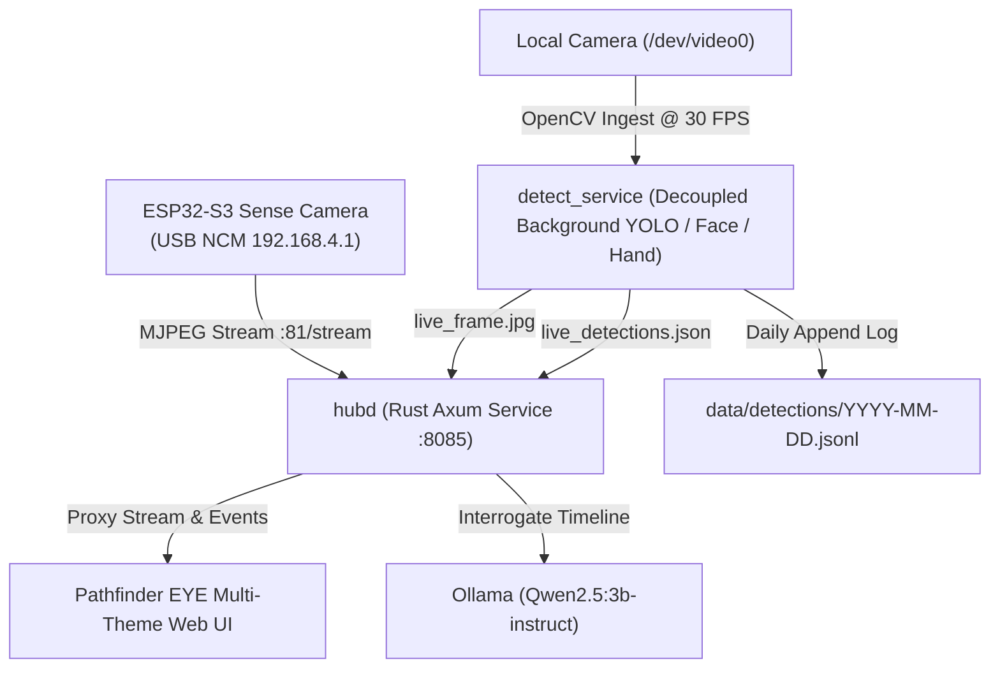

# Pathfinder EYE (ESP32-S3 Vision Hub)

A high-performance computer vision, biometric, robotics CAD, and telemetry edge hub bridging an ESP32-S3 camera module (over USB NCM Ethernet or UVC) with a host-side Rust orchestration daemon, decoupled YOLOv11M ONNX inference engine, 3D facial biometric tracking, 21-joint skeletal hand tracking with Japanese Sign Language (JSL) dictionary, touchless interactive WebGL CAD models, 45,000 GPU particle galaxy flow, cute robot avatar emotion mimicry, append-only JSONL event persistence, and local SLM (Small Language Model) timeline interrogation.

---

## 1. System Architecture



### Components
- **`firmware/`**: ESP-IDF v5.3+ firmware for Seeed Studio XIAO ESP32-S3 Sense. Configures USB High-Speed NCM (CDC-NCM) with a built-in LwIP DHCP server (`192.168.4.1`) streaming camera frames over HTTP port 81.
- **`crates/hubd/`**: Core orchestrator and web server built with Axum and Tokio. Serves live JPEG proxies, atomic JSON telemetry, mode switching, timeline querying, and forwards natural language questions to Ollama. Automatically manages detector background workers.
- **`crates/detect_service.py`**: High-performance vision service running a 30 FPS ingest thread decoupled from asynchronous background YOLOv11M inference, YuNet face tracking, and MediaPipe hand tracking. Includes exposure filters (DARK / NORM / BRIGHT / AUTO / CLAHE).
- **`crates/hand_detector.py`**: MediaPipe ONNX 21-landmark neural geometry detector with custom Japanese Sign Language (JSL) and symbolic gesture classifier (JSL 1–5, Kitsune 🦊, Pinky Promise 🤙, OK/Money 👌, Thumbs Up 👍, Fist ✊).
- **`crates/face_service.py`**: YuNet & SFace biometric pipeline providing 128-dimensional facial embeddings and persistent subject enrollment.
- **`crates/detect/`**: Rust temporal debounce filtering crate guaranteeing object detection persistence and zone tracking across continuous frames.
- **`crates/vision/`**: Streaming MJPEG extraction engine parsing SOI (`0xFF 0xD8`) and EOI (`0xFF 0xD9`) frame boundaries.
- **`crates/store/`**: Structured JSON Lines append-only persistence layer supporting date partitioning and daily detection aggregation.
- **`ui/`**: Hardware-accelerated cybernetic web interface featuring Mazzaroth design themes, 3D face mesh wiring that follows head movement, live JSL gesture menu, interactive touchless 3D CAD viewer, GPU particle galaxy flow, cute robot avatar expression mimicry, and SLM console.

---

## 2. Key System Modes & Features

1. **Object Recognition Matrix (`OBJECT_DETECT`)**:
   - Deep nested wireframe bounding frames with outer alignment ticks, procedural `+` and `*` targeting glyphs, coordinate telemetry (`XY:[x,y]`, `DIM:WxH`), and live Arch Linux kernel log stream on the viewport.
2. **3D Biometric Facial Reticle (`FACE_BIOMETRIC`)**:
   - 468-point 3D facial wireframe mesh tracking head topology in real time.
   - Independent pupil tracking reticles with blink suppression and cyan/amber glow cores.
   - High-contrast borderless holographic visor with `.ID` center callout and dynamic stretching mouth wireframe box.
3. **Cute Robot Avatar Emotion Mimicry (`EMOTION_READER`)**:
   - Parametric vector robot display screen inside physical dark metallic bezel with CRT scanlines and screen vignette.
   - Live expression mimicry: responsive smiling arches (`∩ ◡ ∩`), winking, blinking, gaze tracking, speech lip articulation, and angry chevron expression (`> ^ <`).
   - Floating corner Picture-in-Picture (PIP) webcam feed displaying real-time 3D landmark points and eyebrow contours.
4. **Japanese Sign Language (JSL) & Hand CV Dictionary (`HAND_GESTURE`)**:
   - Dual-hand 21-joint skeletal tracking with interactive sidebar gesture dictionary.
   - Disambiguated Kitsune 🦊 and Rock 🤘 detection based on ring/middle knuckle curl ratios.
5. **Interactive 3D Holographic CAD Viewport (`INTERACTIVE_3D`)**:
   - WebGL Three.js multi-component models: **Turbofan Jet Engine**, **Robotic Arm**, **Planetary Gearbox**, and **Quadcopter Drone**.
   - Touchless controls: single-hand orbit, dual-hand bimanual roll/twist, stretch zoom, and fist-to-palm component disassembly explosion.
   - Drag-and-drop ingestion of custom `.glb`, `.gltf`, and `.stl` models.
6. **45,000 GPU Particle Flow Simulation (`PARTICLE_FLOW`)**:
   - Dual-state GPU particle system morphing dynamically between a dense cybernetic energy core and an expansive 4-arm spiral galaxy driven by hand gestures.
7. **Avian Perimeter Defense Radar (`BIRD_DETECT`)**:
   - Real-time avian robotics CV tracking flight vectors, radial distance, and perimeter defense zones.
8. **Mazzaroth Color Themes**:
   - Instant live palette switching (`Midnight Gold`, `Synth Magenta`, `Obsidian Mono`, `Technical Paper`) propagating seamlessly across 2D canvases, Three.js CAD shaders, particle systems, and web controls.

---

## 3. Getting Started

### Prerequisites
- Rust 1.78+ (`cargo`)
- Python 3.10+ in `.venv` with `ultralytics`, `onnxruntime`, `opencv-python-headless`
- Local Ollama running `qwen2.5:3b-instruct` (optional, for AI timeline queries)

### Running the System
```bash
vision
# Or via script:
./start.sh
```
Open **`http://localhost:8085`** in your browser.
