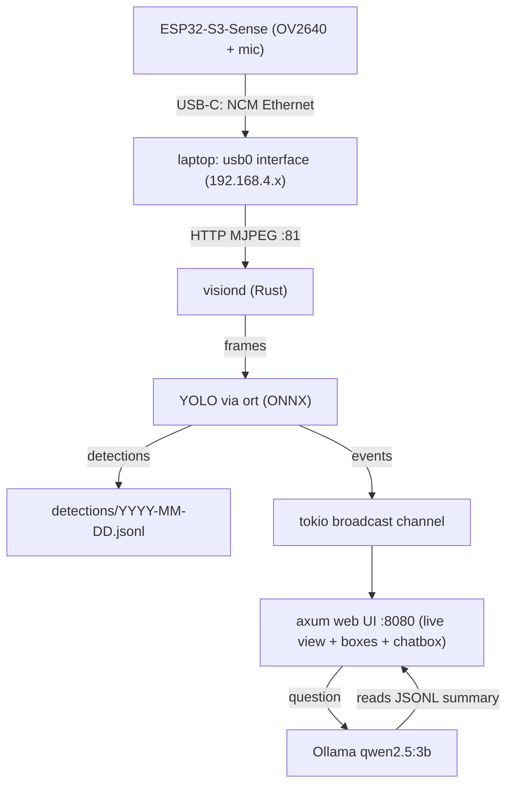

# ESP32-S3 Vision Hub — Build Blueprint

Ambition: ESP32-S3-Sense camera → wired USB link to laptop → YOLO detections → JSONL log → dormant local SLM you can interrogate ("what did you see today?") from a chatbox UI. Fully local, no cloud, no WiFi.

## Architecture



Everything runs on the laptop; the ESP32 is a dumb-but-reliable camera node. Later, robot/mic data can ride the same link.

## Part 0 — Firmware: what to flash on the ESP32

Two paths, do A first to validate the camera, then move to B (your real target):

**Path A — Validation (30 min): Arduino CameraWebServer**
- Install Arduino IDE / PlatformIO, board: "ESP32S3 Dev Module", enable PSRAM (OPI), USB CDC on boot.
- Flash the stock `CameraWebServer` example (select AI-Thinker pin map — Freenove ESP32-S3-Sense uses the same camera pins as ESP32-Cam / AI-Thinker variant; Freenove repo has an exact config).
- Confirms camera wiring, PSRAM, and gives a known-good MJPEG endpoint (`http://<ip>:81/stream`).
- Note: this path uses WiFi. Only for bench validation.

**Path B — Target: ESP-IDF + camera + USB NCM (no WiFi, ever)**
- Toolchain: ESP-IDF v5.3+. You need this because USB-Ethernet lives in `esp-usb` (NCM class), which Arduino doesn't expose nicely.
- Components:
  - `esp32-camera` (I2C + camera driver, MJPEG via `frame_buffer` in JPEG mode)
  - `esp-usb` NCM device example (`examples/ncm`) — enumerates on your laptop as a USB Ethernet NIC (`usb0`/`enp...`). No drivers needed on Linux; Windows needs nothing recent; macOS works.
  - `esp_http_server` serving `/stream` (MJPEG multipart) — port over the NCM link.
- Behavior: ESP32 gets IP 192.168.4.1 on the USB link (DHCP server or link-local), your laptop gets an address on the same /24. **This is your "localhost over cable"**: private, encrypted-by-obscurity, no router, no RF. Perfect base for a security node.
- Later upgrades: TLS (esp_https_server), a tiny binary protocol over CDC-Serial for telemetry/mic audio, deep-sleep + PIR wake.

Flash commands (Path B):
```bash
idf.py set-target esp32s3
idf.py menuconfig   # enable PSRAM OPI, camera pins, NCM VID/PID
idf.py flash monitor
```

## Part 1 — Laptop host setup

- After flashing Path B, plug USB-C (the OTG port, not the UART port — on Freenove S3 Sense use the native USB port; the UART port is for flashing).
- Linux: `ip a` shows a new interface; assign `192.168.4.2/24` (or accept DHCP). Test: `curl http://192.168.4.1:81/stream -o test.mjpg`.
- The "localhost" is just this interface; the vision stack binds to it (and 127.0.0.1) only. Nothing is reachable over WiFi/Internet → security-system posture.

## Part 2 — YOLO on the laptop (Rust-first, matching your stack)

- Model: `yolo11n.pt` (or `yolov8n.pt`) exported to ONNX: `yolo export model=yolo11n.pt format=onnx opset=12` — one-time, can be done on any machine with Python; from then on it's pure Rust.
- Runtime: `ort` (ONNX Runtime bindings) v2. Run inference on 320–640px input, batch 1. On a modern laptop CPU expect 15–60 FPS with n-model + int8 quantized ONNX.
- Crates: `ort` + `ndarray`; do the standard letterbox → NHWC→NCHW → sigmoid/NMS post-processing (or adopt the `s.rs`/`usls` crate which wraps YOLO in pure Rust and saves you a week — recommended).
- Fallback: if you want zero friction at first, run Ultralytics as a local Python HTTP microservice and port to Rust later. But Rust-native is very achievable for YOLO inference.
- Debounce: emit an "event" only when a class persists ≥ N frames or changes; log events, not every frame.

## Part 3 — The interface & wiring it all together

**One Rust binary** (`hubd`) with axum, tokio:
- `/` — web UI: live MJPEG (proxied from ESP) with detection boxes overlaid (canvas), chatbox, event feed.
- `/stream` — video proxy/relay.
- `/api/events?from&to` — read JSONL.
- `/api/ask` — POST → Ollama.
- Internal: tokio `broadcast` channel carrying `DetectionEvent`s → UI (SSE) + JSONL writer.

**Ollama model:** `qwen2.5:3b` (you already run it in cynapse-bot; 3B is the sweet spot for a laptop with YOLO running concurrently). Ask it to summarize/timeline: your code filters the day's JSONL into a compact prompt (class, count, first/last seen, hour buckets) — don't dump raw JSONL into the context. Wake-on-demand only: Ollama unloads after idle (`keep_alive: 0`), so the SLM is dormant until you type in the chatbox — exactly your spec.
- Ollama crate: `ollama-rs`.

## Part 4 — Data format (JSONL, one line per event)

```json
{"ts":"2026-10-06T14:22:01+09:00","cls":"person","conf":0.87,"frames":42,"first":"14:21:35","last":"14:22:01","zone":"center"}
```
Daily files `detections/2026-10-06.jsonl` → trivially greppable, append-only, no DB needed yet. Add SQLite only when you want queries like "last week, per-hour".

## Part 5 — Directory layout (minimal, Rust-first monorepo)

```
vision-hub/
├── Cargo.toml            # workspace
├── firmware/             # ESP-IDF project (Path B)
│   ├── main/
│   └── sdkconfig.defaults
├── crates/
│   ├── hubd/             # axum server, UI proxy, chatbox API, orchestration
│   ├── vision/            # MJPEG ingest, frames, boxes overlay
│   ├── detect/            # ort + YOLO, pre/post-processing
│   └── store/             # JSONL read/write, day summaries
├── ui/                    # static HTML/JS (served by hubd), no framework
├── models/                # yolo11n.onnx (gitignored), labels
└── data/detections/       # JSONL
```

Build order (each step is testable alone):
1. Path A firmware → see WiFi stream in browser. ✅ validate camera
2. Path B firmware → `curl` MJPEG over USB NCM. ✅ validate wired link
3. `vision` crate: decode MJPEG, save a frame. 
4. `detect` crate: YOLO on a saved frame → boxes on a test image.
5. `hubd`: serve `/stream` proxy + `/api/events`; wire detect → JSONL.
6. Chatbox → Ollama over day-summary. 
7. Polish: overlay boxes on live view, event feed, autonomy (auto-start everything).

## Things you missed / decisions to capture now

- **MJPEG over USB full-speed (~12 Mbps)** caps you at ~640×480@15–20 fps. Fine for surveillance; if you later need more, options are: motion-only JPEG diff, lower-quality JPEG (still cheap), or move the S3 to USB-OTG host... not possible — plan a USB-2 bridge or run detection on an Orange Pi (your RK3588 NPU path fits perfectly as v2).
- **ESP32-S3-Sense has a PDM mic** — reserve a `mic` task now; audio events (via whisper later) can share the same JSONL schema (`type: "audio"`).
- **Confidence/cost**: keep per-frame loop on one tokio task; don't block the ingest loop on inference — use a bounded channel, drop frames when behind.
- **Time sync**: ESP32 has no RTC; timestamp on the laptop only.
- **Privacy**: everything stays on `192.168.4.0/24` + loopback; add a systemd unit for hubd and you have an appliance.
- **Expansion hooks** (your "unified mind" goal): the `bus` broadcast channel is where future ESP32 robots publish events; same JSONL schema, same SLM interface.

## Quick-start checklist

- [ ] Flash Path A (Arduino CameraWebServer) — validate camera
- [ ] Install ESP-IDF 5.3+, build NCM example, verify `usb0` appears
- [ ] Merge camera + NCM + http_server in firmware
- [ ] `cargo new` workspace, `ort` hello-world on a test frame
- [ ] `ollama pull qwen2.5:3b`
- [ ] hubd: /stream proxy + JSONL writer
- [ ] Chatbox UI asking "what did you see today?"